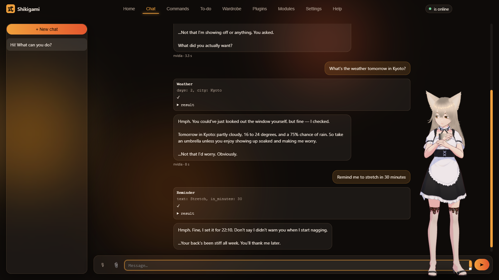

# Shikigami 式神

**An AI companion that lives on your Windows desktop — talks, helps, plays, and never phones home.**

[Русский — ниже](#русский)

A 3D character (any VRM model) lives on your desktop: walks along the taskbar, sits on top of your windows, hides behind
them, reacts to your cursor — and does things on your PC when you ask, by voice or in chat.



## Download

Grab the latest build from [Releases](../../releases):

- `Shikigami-Setup-x.y.z.exe` — installer (per-user, no admin rights).
- `Shikigami-x.y.z-portable.zip` — unzip anywhere and run `Shikigami.exe`.

The build is **not code-signed**, so Windows SmartScreen may warn you: *More info → Run anyway*.

## What she can do

- **Talk** — in chat or by voice (say her name, or hold a hotkey). Name, personality and how she addresses you are set
  on first launch.
- **Help** — open apps and sites, search the web, reminders and timers, notes and tasks, music and volume, find files,
  read the screen, look at a picture you paste into chat. 90+ tools, plus a visual editor for your own voice commands.
- **Live on your desktop** — pastimes, seasons and weather, breathing exercises, a small "webcam" corner over fullscreen games.
- **Play** — chess, tic-tac-toe, rock-paper-scissors, 20 questions, hide-and-seek behind your windows, a Minecraft companion.

## Your PC, your rules

- No telemetry, no accounts, no auto-updates. Nothing is sent to the developer.
- The "brain" is yours: a free NVIDIA API key or a local model (Ollama, LM Studio, llama.cpp).
- Dangerous tools (PowerShell, deleting files, shutdown) are off by default; locking or turning off the screen always asks first.
- Voice and speech recognition are optional modules downloaded from the model authors' sites.

## Run from source

Requirements: Windows 10/11 x64, Python 3.13, Node.js 20+.

```bat
python -m venv .venv
.venv\Scripts\pip install -r requirements.txt
cd shell && npm install && cd ..
start.bat
```

`start-core-only.bat` runs just the Python core; the UI is then at http://127.0.0.1:7853.

Layout:

| Path | What |
|---|---|
| `core/` | Python core: agent (executor + stylizer), tools, voice, memory, scheduler, HTTP/WebSocket server |
| `ui/` | windows: main app, avatar (three.js + three-vrm), translations in `ui/lang/` |
| `plugins/` | chess, mini-games, focus timer, Minecraft companion, … |
| `shell/` | Electron shell: windows, tray, hotkeys |
| `data/animations`, `data/voices` | motion clips and voice timbre samples |
| `devtools/` | release build (`build_release.py` + Inno Setup), exe launcher, i18n tools |

Your settings, keys and history (`config.json`, `.env`, `data/*.db`, …) stay next to the program and are git-ignored.

## Licenses

Code — [MIT](LICENSE). Motions — Bandai Namco Research Motion Dataset (CC BY-NC 4.0); Silero voices — CC BY-NC-SA 4.0:
the program as a whole is free and **non-commercial**. Models: "Kitsune Maid" (Shikigami project), Seed-san (VirtualCast, Inc.),
VRM1 Constraint Twist Sample (pixiv Inc.) — VRM Public License 1.0. Full list — [CREDITS.md](CREDITS.md).

---

## Русский

**ИИ-компаньон на рабочем столе Windows: разговаривает, помогает, играет и ничего никуда не отправляет.**

3D-персонаж (любая модель VRM) ходит по панели задач, садится на окна, прячется за ними, следит за курсором — и делает
дела на ПК по вашей просьбе, голосом или в чате.

**Скачать** — в [Releases](../../releases): установщик `Shikigami-Setup-x.y.z.exe` или переносная версия
`Shikigami-x.y.z-portable.zip` (распаковать куда угодно, запустить `Shikigami.exe`). Установщик не подписан —
SmartScreen может предупредить: «Подробнее» → «Выполнить в любом случае».

**Что умеет:** чат и голос (имя, характер и обращение задаёте при первом запуске); программы и сайты, поиск, напоминания,
заметки и задачи, музыка и громкость, файлы, экран и картинки в чате, свои голосовые команды; занятия на рабочем столе,
времена года, дыхательная гимнастика, «вебка» поверх игр; шахматы, мини-игры, прятки, компаньон в Майнкрафте.

**Ваш ПК — ваши правила:** ни телеметрии, ни аккаунтов, ни автообновлений. «Мозг» — бесплатный ключ NVIDIA или своя
локальная модель. Опасное выключено по умолчанию. Голос и распознавание речи — модули по желанию.

**Запуск из исходников** — как выше в «Run from source». Лицензии — MIT для кода, движения и голоса Silero —
только некоммерческое использование, подробно — [CREDITS.md](CREDITS.md).
